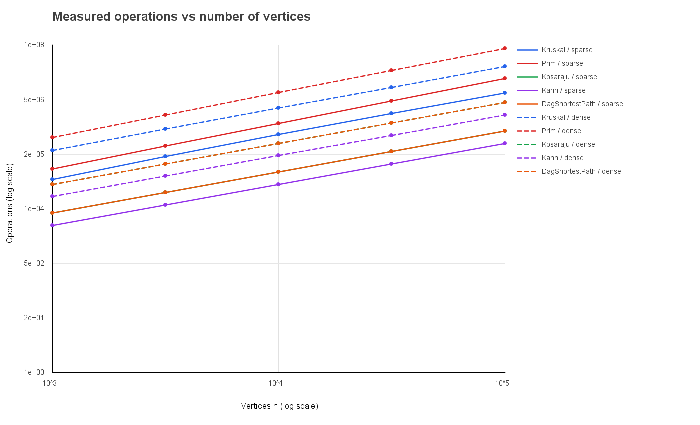
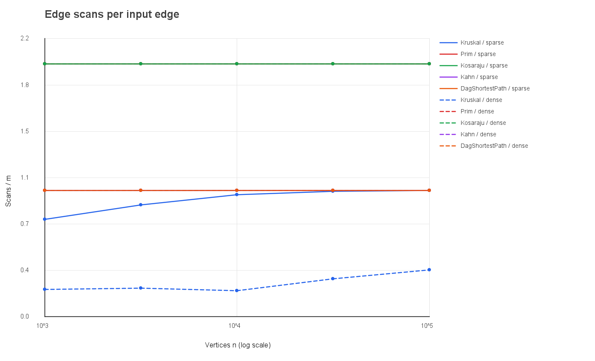
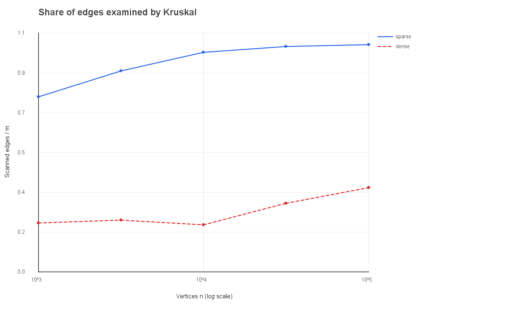

# Assignment 3 - Graph Algorithms

## 1. Implementation and experiment

The implementation uses a single weighted adjacency-list graph class for directed and undirected graphs. Its edge list stores every input edge once; an undirected edge appears in both endpoint adjacency lists. This supports parallel edges, self-loops, isolated vertices, and disconnected input. The deterministic benchmark builds five sizes (`n = 1,000, 3,162, 10,000, 31,623, 100,000`) at two densities (`m = 4n` and `m = 20n`). It creates separate undirected, directed, and DAG inputs, writes 50 algorithm rows to `results/results.csv`, and verifies its outputs against the assignment reference table before saving the data.

The CSV contains the median time from five runs and counters incremented by the algorithms: DSU calls, edge scans, weight comparisons, and maximum explicit-stack depth. Sorting and priority-queue comparator invocations count as weight comparisons. `edgeScans` for Kahn counts the adjacency traversal after indegrees are initialized; this is the traversal specified by the assignment's exact `m` reference. DAG shortest-path counters count its relaxation pass. Initialization work is intentionally not mixed into those traversal counters.

## 2. Complexity

| Algorithm | Time | Extra space | Reason |
|---|---:|---:|---|
| DSU `find` / `union` | amortized `O(α(V))` | `O(V)` for the structure | Union by rank bounds tree height; path compression flattens paths across operations. |
| Kruskal | `O(E log E + E α(V))` | `O(V + E)` | Sorts the edge list and uses DSU while examining edges. |
| Prim | `O((V + E) log V)` | `O(V + E)` | Each vertex and adjacency edge is handled with a binary priority queue. |
| Kosaraju | `O(V + E)` | `O(V + E)` | Two DFS passes and a reversed graph each take linear time and storage. |
| Kahn | `O(V + E)` | `O(V)` | Computes indegrees, queues ready vertices, and visits outgoing edges once. |
| DAG shortest paths | `O(V + E)` | `O(V)` | Uses a topological order and relaxes every edge once. |
| Tarjan SCC | `O(V + E)` | `O(V + E)` | One iterative DFS tracks discovery indices, lowlinks, and active vertices. |
| Condensation + DAG longest path | `O(V + E)` | `O(V + E)` | Maps SCCs, copies cross-component edges, then relaxes the condensed DAG once. |

The DSU cost is amortized over a sequence of operations; `α(V)` is the inverse Ackermann function and grows so slowly that it is effectively constant for practical input sizes. For disconnected graphs, Kruskal and Prim return a minimum spanning forest and component count.

## 3. Counter checks and measured slopes

The traversal counters reproduce exact ratios at every size. Kosaraju scans `2m`, so `edgeScans/(V+E)` is `1.60` for the `m=4V` inputs and `1.9048` for `m=20V`; those ratios stay unchanged from 1,000 to 100,000 vertices. Kahn and DAG relaxation scan `m`, giving ratios `0.80` and `0.9524`. Prim scans both adjacency entries of every undirected edge, giving `2m` and the same two stable normalized ratios as Kosaraju.

Kruskal's `edgeScans/m` changes as the graph grows because the algorithm stops once the connected input has `V-1` selected edges. On sparse inputs it rises from `0.7705` at 1,000 vertices to `0.9992` at 100,000. On dense inputs it rises from `0.2151` to `0.3718`: a greater fraction of the dense edge list can be skipped once the MST has been found. The number of DSU operations is `find calls + successful unions`; `dsuOps/m` for Kruskal rises from `1.7908` to `2.2483` in the sparse series and from `0.4802` to `0.7936` in the dense series, approaching a stable multiple of the `O(E)` edge work for each density family. Kruskal's sorting comparisons divided by `E log2(E)` are between `0.67` and `0.90` in these samples.

Ordinary least-squares fits on log-log `edgeScans` versus `n` give slope `1.000` for the linear traversals (Kahn, Kosaraju, DAG shortest paths, and Prim). Kruskal's measured scan slopes are `1.055` on sparse graphs and `1.119` on dense graphs. Its full time bound also includes edge sorting, `O(E log E)`; the scan counter alone does not count the complete sorting cost, so the separate comparison counter is needed to discuss that factor.

## 4. Correctness arguments

**MST cut property.** Consider any cut that separates the current forest into two sides. The lightest edge crossing that cut is safe to add: if an MST did not contain it, adding it to that MST would create a cycle, and removing another edge crossing the same cut would produce a tree no heavier than the original. Kruskal processes edges in nondecreasing weight, so when it joins two different DSU components, the edge is a lightest available connection between the components and preserves the possibility of an MST. DSU rejects edges whose endpoints are already connected, which prevents cycles. Prim grows a tree from a starting vertex by repeatedly choosing the least-weight edge from the current tree to an outside vertex. That edge is the lightest edge across the cut formed by the current tree and the remaining vertices, so the same cut property makes each choice safe. Continuing from each unvisited vertex extends Prim to a minimum spanning forest on a disconnected graph. The benchmark compares the two total weights on all ten generated undirected graphs.

**One-pass DAG relaxation.** A topological order places every predecessor of a vertex before that vertex. For a source, the initialized distance is already the shortest distance from the virtual super-source. Assume all vertices before `v` have their shortest distances when `v` is reached. Every path to `v` ends in an edge `u → v`, and each such predecessor `u` is earlier in the order, so its distance has already been finalized. Relaxing each outgoing edge from each vertex therefore considers every possible last edge of every path exactly when its start vertex is settled. The best candidate becomes the shortest distance to its endpoint. By induction the values are correct for all vertices after one pass. Negative weights are safe because a DAG has no cycle that can be repeated to reduce a path indefinitely; negative weights in a general graph can create a reachable negative cycle, for which a finite shortest path may not exist.

## 5. Algorithm selection

| Situation | Choice | Why |
|---|---|---|
| Sparse undirected weighted graph; want a spanning tree/forest | Kruskal | Edge sorting plus DSU is simple when edges are already in a list; the scan counter shows it may examine almost all sparse edges. |
| Dense undirected weighted graph; adjacency list available | Prim | It grows the tree directly from adjacency lists and can avoid examining much of the sorted edge list. |
| Need strongly connected groups in a directed graph | Kosaraju | Linear-time SCC algorithm; iterative DFS is safe at 100,000 vertices. |
| Need a dependency order and must detect cycles | Kahn | A complete order proves acyclicity; fewer than `V` output vertices signals a cycle. |
| Directed graph is a DAG, including negative edge weights | DAG shortest paths | One topological pass is linear and supports negative weights without Bellman-Ford's repeated scans. |
| Cycles may occur and shortest paths are needed | Do not use DAG relaxation | First establish acyclicity or choose an algorithm designed for general graphs and negative-cycle handling. |

The generated benchmark's median times varied with graph density and algorithm, and are recorded per row in the CSV. They are useful for describing this one machine, but are not the main evidence: hardware, JVM version, warm-up, and background load can change wall-clock time. The operation counters and exact scan ratios are reproducible and directly tied to the code's work.

## 6. Bonus tasks

**Tarjan SCC.** The iterative Tarjan implementation keeps `index`, `lowlink`, and an active-vertex stack, while explicit DFS frames preserve the next adjacency position without using the JVM call stack. It returns the same SCC partition as Kosaraju on the random tests and the directed example graph. Tarjan examines each directed edge once (`m` scans); Kosaraju examines each edge in both passes (`2m` scans). The benchmark verifies both the partition and these scan counts for all ten generated directed graphs, and writes the measurements to `results/tarjan-scan-comparison.csv`. This saves half of the edge scans and avoids constructing and traversing the reversed graph.

**Condensation and critical path.** The condensation builder maps each SCC to one vertex and keeps every cross-component edge with its weight; edges inside an SCC are omitted. The result is a DAG because a cycle between distinct components would make those components one larger SCC. The longest-path routine takes a topological order and minimizes the negated edge weights, then negates the resulting distances. It starts every zero-indegree component at distance zero, so the result represents the longest path from any source component. This takes `O(V + E)` time on the condensation graph. A critical path can model the longest dependency chain in a schedule. Longest simple path is NP-hard in a general graph; for longest walks, a positive-weight cycle can make the value unbounded. The condensed DAG has neither issue and can be solved in linear time.
